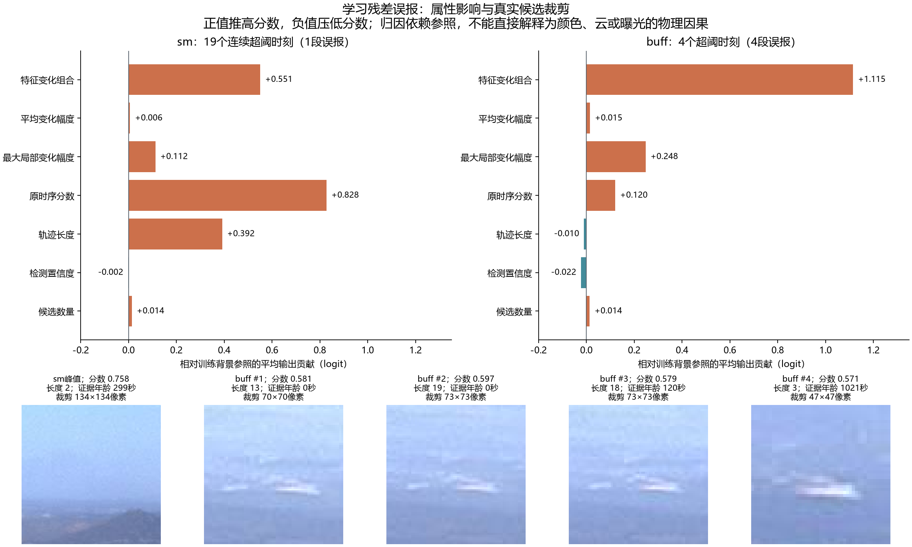

# 实验六：正常片段误报的属性分析

范围：冻结的baseline/seed_42，确认正常的HPWREN片段。与Junction是否适合作为火情正例、ml-w遮挡烟雾的重新解释无关；本分析不修改火情资格、标签、模型、阈值或正式汇总。

## 已确认的结论

5段学习残差误报集中在两个正常片段：sm的19个连续超阈时刻合为1段，buff的4个孤立超阈时刻合为4段。它们不是5种独立背景条件；buff的候选集中于同一小片天际线附近。

### sm：原始时序误判、融合重评分与旧证据延续共同作用

这19个时刻的原时序logit恒为5.803162，长度恒为2，平均检测置信度恒为0.166932，候选数恒为1；最后真实检测时刻也相同，证据年龄从0增长至1080秒。对应候选裁剪约134×134原始像素。

官方校准概率为0.428017，低于其验证阈值0.541115；仅校准组为0.567659，高于其阈值0.488657。仅校准组没有残差输入，因此这段误报不能全部归因于学习预测器。

仅校准线性头对该样本的输出logit分解：原时序分数项+0.490957、长度项+0.135275、检测置信度项+0.024013、候选数量项+0.016645、偏置−0.394583，总和约+0.272307，经sigmoid得到0.567659。不同模型的权重、偏置、工作阈值不同，不能把跨模型分数差直接解释成某个属性的因果效应。

学习残差头相对训练背景均值参照的平均logit贡献中：原时序分数约+0.828，残差特征组合约+0.551，长度约+0.392，最大局部变化幅度约+0.112，其余项较小。它同时受到原始证据和残差组合影响。

最关键的持续机制是：已记录的age_seconds没有作为基础属性输入融合头，当前帧是否存在真实支持检测也没有作为显式输入。相同旧轨迹因此可以在后续窗口继续贡献高分。新鲜度机制可针对延续问题，但不能消除证据年龄为0时已经产生的首次误报。

### buff：残差组合主导的4次跨阈

| 次序 | 原版分数 | 均值残差分数 | 学习残差分数 | 轨迹长度 | 证据年龄/秒 | 检测置信度 | 原始裁剪像素 |
|---|---:|---:|---:|---:|---:|---:|---:|
| 1 | 0.0805 | 0.0921 | 0.5810 | 13 | 0 | 0.1422 | 70×70 |
| 2 | 0.2675 | 0.0908 | 0.5970 | 19 | 0 | 0.1495 | 73×73 |
| 3 | 0.2634 | 0.0671 | 0.5790 | 18 | 120 | 0.1451 | 73×73 |
| 4 | 0.0089 | 0.3698 | 0.5705 | 3 | 1021 | 0.1107 | 47×47 |

这4次候选数都是1；学习残差阈值为0.562522，均值残差阈值0.792131，原版验证阈值0.541115。各分数不是统一校准尺度，不作分数倍率比较。

学习残差头的平均logit贡献主要来自残差特征组合+1.115、最大局部变化幅度+0.248、原时序分数+0.120。平均变化幅度只有约+0.015，检测置信度约−0.022，候选数量约+0.014。

长度效应并非“越长越报警”：前三条长度项相对参照分别约−0.052、−0.155、−0.140，在压低分数；第四条短轨迹长度项约+0.309，在推高分数。该非线性融合头的具体作用依样本而变，不能套用原版校准器的单调长度奖励。

保持其它输入不变，将整个残差输入块替换为训练背景平均参照后，4次学习残差分数分别变为约0.239、0.238、0.243、0.324，均低于阈值。单独替换残差特征组合或最大局部变化幅度，也均使4次分数降至阈值以下。这是模型对这些输入敏感的证据，不是现实画面被改变后的因果实验。

## “残差大”并不能单独解释误报

学习残差在sm候选上的平均残差幅度约0.310；没有跨阈的ws候选约0.319，反而更大。buff的4次超阈候选平均约0.467，其全部有特征候选约0.445，仅略高。

实际融合使用的是最近3次残差，每次包含空间平均的384维特征差、局部残差范数的平均值和最大值。它会学习“哪些深度特征以何种组合变化”，而非单一残差大小门限。这里的特征方向不是烟雾的运动方向。

因此不能直接宣称模型因“云的白色”“向上运动”“曝光变化”而误报。DINO特征可能包含这类信息，但本轮尚未把具体物理因素分别隔离验证。裁剪原图仅用于定位和观察，不作为物理原因的证明。

## 背景预测与训练覆盖的限制

此前在正常固定区域缓存上的对照发现：学习预测器的测试余弦误差比均值参考高约23.2%。本次在buff实际候选缓存上，其平均残差幅度约0.445，均值参考约0.310。这两项统计口径不同，都不能直接等同于烟雾判别质量，但支持继续检查背景预测泛化和裁剪采样差异。

正常预测器以3×3固定大区域训练；buff误报实际输入来自47～73像素的小裁剪，随后送入224像素图像编码器，存在采样尺度与内容分布差异的可能。小裁剪本身不能证明导致误报，真正薄烟也可能很小。

验证正常观测只有7.9475摄像头小时，一次误报即超过0.1次/小时参考约束，因此各方法的阈值都被选到验证零误报。测试跨阈说明该工作点未稳定迁移，不能用测试结果反向调整阈值后再报告独立成绩。

## 应优先验证的改动

1. 增加证据年龄、当前真实支持检测、近期真实观测数量；分别测量对首次误报与持续误报的影响。
2. 对原时序高分但检测置信度低、真实支持少的背景候选补充训练负例与分层校准，避免只奖励新生短轨迹。
3. 用与实际候选裁剪匹配的正常样本校验背景预测器，并检验可靠性权重、均值参考退回和邻域对照。
4. 保留平均与最大残差幅度的独立消融；不要把残差幅度大直接当烟，也不要仅提高检测阈值来换取表面误报改善。

上述规则需要回到train/val选择并冻结，在新的独立片段验证，不能针对这两段测试背景指定专用参数。

## 方法与复核边界

脚本从257条有特征且标为背景的训练候选计算融合输入均值参照，对Linear-ReLU-Linear融合头使用分段线性的解析积分梯度。所有分组贡献之和精确等于该样本相对参照的输出logit差异；这是一种依赖参照的数值解释，不是物理因果结论。输入块替换也可能产生未实际观测的特征组合。

对193条有特征的正常测试候选，手工重组输入后的分数与保存分数最大绝对差小于0.000001，积分梯度完整性误差小于0.00000001。其余无特征候选按原程序退回官方概率，不进入本次特征归因；正常误报段和时长仍使用正式评价的完整观测分母。

完整逐条输入、残差幅度、分组贡献和替换敏感性见false_alarm_diagnostics.json；脚本见false_alarm_diagnostics.py。

