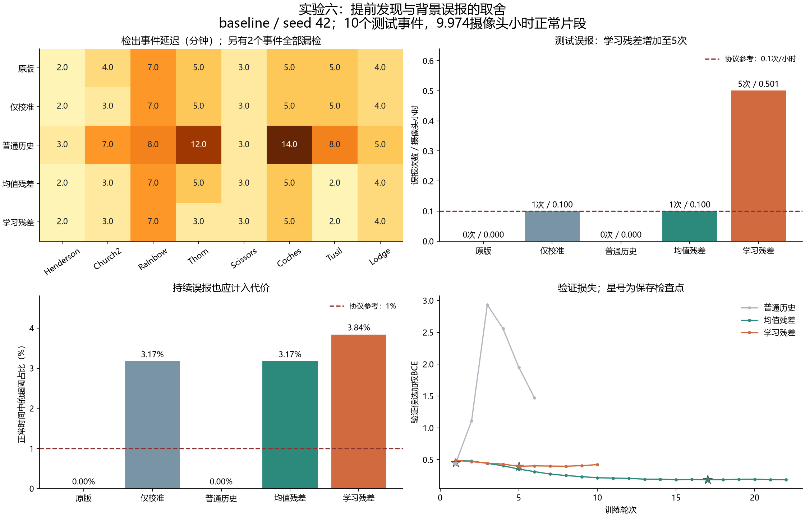

# 实验六结果深入分析

分析日期：2026-10-22（北京时间）。分析对象：`exp006_main_20261021 / baseline / seed_42`，检测设置0.10/1024。正式测试于北京时间20:05:57生成，阈值于18:52:07冻结。高分辨率1536及43/44种子尚无正式结果，不包含在本结论中。

**后续复核补充（2026-10-22）：** 本文8/10和下表按冻结清单保留原始程序成绩。用户说明Junction是因为没有看出烟而标为背景，其可见目标烟雾资格仍需完整序列确认；ml-w则在左侧器械遮挡下有烟，现有右侧候选未覆盖它。因此“两个漏检”在本文是程序统计状态，不能直接等同两个均已确认合格的正例漏检。未据此修改标签、阈值或正式输出，也未排除困难正例。当前测试已经用于诊断，后续方案的最终评价须另用新的隔离数据。综合路线与PSL分支见[问题汇总](../../../RESEARCH_ROADMAP.md)。

## 结论与决策

本轮验证了**局部残差分支在少数事件上可以更早给出正确区域的高分**，但没有证明“学习正常背景预测”在当前实现中优于简单均值参考。学习残差没有提高事件检出率、5分钟召回或10分钟召回，却增加了正常场景误报；因此没有达到同时改善早期发现和背景抑制的实验目标，当前不宜替换原版作为默认方案。

应保留这轮结果作为机制诊断证据：优先处理旧轨迹反复告警、正常预测器泛化及目标候选覆盖问题。均值残差是后续必须保留的强对照，它本身也存在持续误报，不能直接作为已验证的部署改进。

## 1. 结果可信度与实际完成范围

本分析直接读取正式运行的`test_predictions.jsonl`、`summary.json`、`thresholds.json`、完整候选记录、原图清单、当前人工标签、5个新增模块检查点及训练日志，没有以README中的旧进度代替实际输出。

完成的复核：

- 从793条测试候选记录独立重算每个事件的首次正确定位、事件召回、正常观测时长、误报段和超阈时长，结果与正式汇总一致；正常片段无候选的帧仍计入观测时间。
- 使用冻结权重重新计算全部793条记录的四个融合分数，逐值与保存分数相同，最大绝对差均为0；原版分数与保存的官方概率相同。这里没有重跑YOLO或DINOv2。
- 协议、数据选择、特征提取脚本、四个融合检查点的实际SHA256，以及训练/验证标签指纹均与冻结记录一致；特征提取为完整运行。
- train/val/test按站点和事件组隔离，分别覆盖18/8/8个站点；清单中的原图哈希不存在跨组重复。5607张活动原图均存在且文件大小与清单一致。本次未重新计算全部原图内容的SHA256。
- 全部有特征候选的8帧历史时间戳均递增、止于当前时刻，间隔不超过120秒，未发现未来帧输入。该检查验证时间记录，不等同于逐个重新提取特征。
- 正常片段实际确认数量为train 9段、val 4段、test 5段，有效时间分别为17.9217、7.9475、9.9742摄像头小时。计划40小时包含2段被排除的正常候选，不能直接作为评价分母。
- 融合训练实际使用971个有特征且有明确标签的候选，其中烟714、背景257；验证使用712个候选。候选是高度相关的连续观测，不能视为971个独立火情。

当前能够确认的是：本轮划分、冻结及计算链路在上述检查范围内一致。与官方Pyronear原始训练数据是否重叠仍未知，不能把本轮测试称为已经证实完全未见的官方模型外部泛化测试。

## 2. 五种方法的整体结果

| 方法 | 检出/事件 | 5分钟召回 | 10分钟召回 | 检出事件中位延迟/min | 正常误报段 | 误报/摄像头小时 | 超阈时间占比 |
|---|---:|---:|---:|---:|---:|---:|---:|
| 原版 | 8/10 | 70% | 80% | 4.49 | 0 | 0 | 0 |
| 仅校准 | 8/10 | 70% | 80% | 4.49 | 1 | 0.1003 | 3.17% |
| 普通历史GRU | 8/10 | 30% | 60% | 7.51 | 0 | 0 | 0 |
| 均值残差 | 8/10 | 70% | 80% | 3.50 | 1 | 0.1003 | 3.17% |
| 学习残差 | 8/10 | 70% | 80% | 2.98 | 5 | 0.5013 | 3.84% |

延迟相对官方首次可见烟羽时间，未包含计算和通信耗时；中位数仅对检出的8个事件计算。两个未检出条目在原程序约40分钟观察窗口内计为漏检，始终保留在原始10事件分母中；资格复核边界见文首补充。官方0分钟不是点火时间。

表中原版使用验证集确定的阈值0.541115；另存的官方默认阈值0.720750在这批测试上得到相同的逐事件延迟、召回和正常误报结果。因此本轮结论不是单纯由降低原版工作阈值造成。



## 3. 提前量来自哪些事件

| 事件 | 首个已确认目标候选/min | 原版/min | 仅校准/min | 均值残差/min | 学习残差/min |
|---|---:|---:|---:|---:|---:|
| Henderson | 2.00 | 2.00 | 2.00 | 2.00 | 2.00 |
| Church2 | 3.00 | 4.00 | 3.00 | 3.00 | 3.00 |
| Rainbow | 7.00 | 7.00 | 7.00 | 7.00 | 7.00 |
| Thorn | 2.97 | 4.98 | 4.98 | 4.98 | 2.97 |
| Junction | 无 | 漏检 | 漏检 | 漏检 | 漏检 |
| Scissors | 2.97 | 2.97 | 2.97 | 2.97 | 2.97 |
| Coches | 5.00 | 5.00 | 5.00 | 5.00 | 5.00 |
| 20240201 FIRE / ml-w | 无 | 漏检 | 漏检 | 漏检 | 漏检 |
| Tusil | 2.02 | 5.00 | 5.00 | 2.02 | 2.02 |
| Lodge | 4.00 | 4.00 | 4.00 | 4.00 | 4.00 |

### 3.1 Church2：校准即可获得的提前

首个目标候选在+3分钟出现。其原版分数0.458812低于阈值0.541115；仅校准分数0.591469超过对应阈值0.488657，且目标本来就是最高分区域。均值和学习残差也在此时检出。因此这1分钟不能作为学习背景预测独有的贡献。

### 3.2 Tusil：主要改善目标区域排序

在+2.02分钟，目标的原版概率已经达到0.960103，超过原版阈值，但另一条标为烟、却不属于本次目标火情的候选更高，为0.998092。评价要求每个时刻最高分区域属于目标，因此原版尚未获得正确定位。

均值残差和学习残差在+2.02分钟都把目标排到首位；仅校准仍由非目标候选获胜。这是区域竞争问题，不能笼统解释为“原分类器看不见薄烟”。Tusil共有100条标为烟但不匹配目标的候选，评价并没有将其当作正确火情发现。

### 3.3 Thorn：学习残差分支独有的局部收益

目标候选在+2.97分钟已出现，原版分数仅0.022976。此时仅校准0.446271、均值残差0.755032都低于各自冻结阈值；学习残差0.689223高于自身阈值0.562522，且目标为最高分区域，使正确发现提前约2.02分钟。

这是本轮最有价值的正面案例。但它证明的是完整学习残差分支在这一个事件上的表现，尚不足以单独证明正常预测器的机制优越性：两个残差分支的融合权重和工作阈值均分别训练/选择，且目前只有一个随机种子。

### 3.4 为什么不能把中位延迟下降直接说成全面提速

中位延迟由4.49降到2.98分钟，两个组中位数相差1.51分钟；但同一事件逐对比较，学习残差相对原版仅3个事件提前、5个不变，平均提前0.75分钟，配对提前量中位数为0。

相对均值残差，学习残差仅Thorn一个事件提前，另7个不变；平均额外提前0.252分钟，约15秒，配对中位数仍为0。这些平均数均只针对共同检出的8个事件，不能外推为所有火情的期望收益。

5分钟和10分钟召回均未提高：被提前的事件原本已在5分钟内检出，Rainbow的目标候选到+7分钟才出现，两个漏检事件也没有被挽回。

## 4. 候选生成已经成为主要瓶颈

学习残差在全部8个检出事件中，都于第一个已确认目标候选出现时正确发现；均值残差达到7/8，原版达到5/8。这里的候选下界依据当前人工标签和保存的候选集合定义。

在同一候选集合和同一评价规则下，单纯继续调整融合分数，已经不能让学习残差在这8个事件更早发现。要进一步提前，需要让目标候选更早进入系统，或者采用能够主动提出区域的新分支。

Junction共82条保留候选、官方起点后42条；ml-w共18条保留候选，均在起点后出现。这些候选在当前人工标签中全部为背景。二者分别存在34个和2个原始检测框，因此不能说“检测器完全没有输出”，准确表述是“未形成经确认的目标烟羽候选”。

由此得到的80%候选覆盖上限，以当前目标归属和背景标签正确为前提。现有结果不能进一步区分目标未检出、关联/轨迹筛选丢失、目标太小或标注遗漏，需要将原始检测框与真实烟羽位置逐帧对应；不能直接归咎于融合头。

## 5. 误报问题比汇总表显示得更具体

### 5.1 sm站点：一次持续约19分钟的错误告警

`normal_20261016_Q4_sm-n-mobo-c`在仅校准、均值残差、学习残差中产生完全相同的19个超阈时刻，按有效时间累计18.983分钟。5分钟告警合并规则将其记为1段，因此必须同时看超阈时间，不能因“只有1次”而忽略持续性。

进一步追踪发现，这19个时刻的轨迹长度始终为2，最后真实检测证据的时间戳始终为1792171582；证据年龄由0增加到1080秒。原版logit始终为5.803162，官方概率始终为0.428017，原版并未跨阈。校准头把它持续提升到0.567659，残差分支也持续跨阈。

因此这次长期误报涉及两个环节：新分支让背景候选跨阈，以及官方历史窗口持续保留仅含2次检测的旧轨迹。没有未来帧泄漏，并不意味着证据足够新鲜。当前融合基础特征只包含logit、跨度、置信度和候选数，没有使用已经记录的`age_seconds`。

### 5.2 buff站点：学习残差新增4次短告警

`normal_20261008_Q4_buff-s-mobo-c`仅学习残差出现4段告警，合计4分钟。它们是4次短暂超阈，彼此间隔超过合并规则，不能与sm的长误报视作同一种失败。对应证据年龄分别为0、0、120、1021秒，既有新鲜背景候选被提升，也有旧轨迹再度跨阈。

学习残差共5段误报、22.983分钟超阈；其中sm占超阈时间约82.6%。这提示后续应分别检查持续背景、轨迹证据年龄和孤立分数尖峰。

### 5.3 火情序列本身也存在错误区域告警

正式误报率仅以独立HPWREN正常片段为分母。补充核对发现，在火情序列官方起点之前，最高分区域经人工标为背景且跨阈的判断时刻，原版为0、仅校准14、普通历史1、均值残差3、学习残差26。

这些是“背景获胜框的超阈时刻数”，不是误报段数，也不是另一个可以直接合并的摄像头小时误报率：没有将所有火情出现前整图都作为确认正常时间计量。它们仍说明，单看首次正确发现会遗漏错误区域告警的代价。

## 6. 背景预测器有没有学到比简单参考更好的正常变化

额外进行了一次只读诊断：使用保存的预测器，对所有确认正常片段的既有特征缓存做预测，与“上一帧直接保持”和“过去5帧特征均值”比较。不训练、不改阈值。采用与训练一致的下一帧归一化特征余弦损失，先对每个片段的有效时刻/局部区域求平均，再对片段等权平均。

| 正常数据划分 | 上一帧保持 | 过去5帧均值 | 学习预测器 |
|---|---:|---:|---:|
| train，9段 | 0.013438 | 0.011970 | **0.010953** |
| val，4段 | 0.007994 | **0.006902** | 0.007854 |
| test，5段 | 0.013601 | **0.011312** | 0.013939 |

学习预测器相对均值参考在训练片段上误差降低约8.5%，但验证误差高约13.8%，测试误差高约23.2%；测试上甚至略差于上一帧保持。这是当前预测器泛化不足的直接迹象。

该诊断评价的是固定3×3正常区域采样下的背景预测，不直接等同于目标候选的烟/背景区分能力，也不能单独证明误报的因果来源。但它使“学习预测比简单均值更准确，因此烟雾残差更有效”的解释失去本轮实证支持。

当前实现用大幅面固定区域训练正常预测器，实际融合却在检测器选择的小候选区域上计算残差，存在采样尺度和内容分布不同的可能；应在相同候选裁剪上增加正常预测对照来验证，不能把这个可能性写成已证实原因。

## 7. 训练过程说明什么

- 普通历史GRU最佳验证损失在第1轮为0.448903；第6轮训练损失降到0.009777，验证损失却升到1.469991，表明强烈的过拟合倾向。正式保存的是第1轮最佳权重，不能用第6轮末状态冒充正式模型。
- 均值残差最佳验证损失0.184548（第17轮），学习残差0.395347（第5轮）。二者使用同样的候选训练和验证集合；均值残差在候选验证目标上表现更好，与其较少测试误报的方向一致，但BCE不是事件级预警性能的替代指标。
- 两种残差融合头均有148,993个可训练参数；学习分支额外使用已训练后冻结的246,912参数正常预测器。数据规模主要仍是20个训练事件，其中19个事件提供了有特征的烟候选，不能因窗口多就认为场景覆盖充分。
- 普通历史比原版更慢，且5分钟召回从70%降到30%，说明“增加历史或GRU容量”在本轮并未自动产生早期检测收益。

## 8. 工作点与小样本限制

验证集实际正常时长为7.9475小时，出现一次误报就达到0.1258次/小时，已经超过协议0.1次/小时。因此所有方法最终都被选到验证集零误报的阈值。它们满足的是同一组验证约束，测试误报率并没有天然匹配；不能把中位延迟比较宣传成“相同测试误报率下的提速”。

仅校准和均值残差的测试0.1003次/小时略高于0.1，差距很小，主要因为实际观察时间略少于10小时；但3.17%的超阈时间已明确高于1%的参考约束。学习残差同时在次数和时长上明显偏离参考值。

原版0次误报/9.974小时也不能证明长期误报率为0。即使在误报服从齐次泊松过程的简化假设下，零次观测的单侧95%率上界仍约0.300次/小时；零误报至少约29.96小时才能把该上界压到0.1。真实站点、天气和时间依赖并不满足简单独立假设，实际仍需更广覆盖的连续正常测试。

测试仅10个事件、8个站点、一个种子；两个事件缺少目标候选，部分事件来自同站点。不得据此声称通用统计显著优势、证明EARL整体无效，或把本轮适配称为完整EARL复现。只有2个事件记录了人工首次可见时间，本分析统一使用官方起点，避免混用参照。

## 9. 建议的下一轮工作顺序

1. **先解决证据新鲜度与误报延续。** 保留原版为当前参考，围绕旧轨迹检查`age_seconds`、当前帧是否有支持检测和真实观测数量；验证带证据年龄的融合、显式失效状态等方案。硬性丢弃旧轨迹可能影响真实烟雾连续性，应在train/val验证后再冻结，不应直接根据测试19分钟片段指定最佳门限。
2. **先让正常预测器通过简单基线，再扩展网络。** 保留上一帧和均值参考，在匹配实际候选裁剪的正常数据上比较预测误差及背景分数分布；检查站点/光照分层和训练规模曲线。若持续不能超过均值参考，优先保留简单残差方案，减少对当前GRU预测器的投入。
3. **单独诊断候选覆盖。** 对Junction、ml-w及Rainbow早期片段，分别检查原始检测、关联保留和目标尺度；高分辨率1536按原定协议另行验证。若目标始终未进入候选集，继续训练融合头无法解决这类漏检。
4. **完成稳定性与独立复核。** 按原协议补42/43/44种子和高分辨率设置，逐事件报告延迟、漏检、错误区域、误报段和占用时长。正常数据优先增加困难背景与更长连续片段。当前测试已经用于本次诊断，后续方案选择应回到train/val，最终结论另用新的隔离站点测试确认。

继续投入学习预测分支的判断条件应包括：在足够的正常观察覆盖下，满足冻结误报约束；不增加漏检；并在多个事件/种子上稳定优于仅校准和均值残差。当前结果尚未满足这些条件。

## 10. 复核文件与复跑

- `audit_results.py`：可复跑分析脚本，仅读取既有数据、特征和权重，写入本分析目录。
- `audit.json`：逐事件、逐正常片段、指纹、损失曲线、候选下界、预测参考对照及分数重算结果。
- `comparison.png`：正式指标、逐事件延迟和验证训练曲线。
- `diagnostic_cases.png`：两次漏检的0/20/40分钟原图，以及正常误报峰值原图；红框为既有候选裁剪，不是新增真值标注。
- `render_cache/`：Matplotlib字体缓存，仅用于绘图。

本次采用随应用提供的Python 3.12.14，加载原实验环境中的PyTorch 2.7.1+cu118、NumPy 1.26.4和Matplotlib，以GPU进行新增模块的只读推理。未改动模型、标签或冻结阈值。复跑命令：

```powershell
& 'C:\Users\HElanfameng\.cache\codex-runtimes\codex-primary-runtime\dependencies\python\python.exe' -B -X utf8 `
  'D:\AIC\AIC-seek\experiments\exp006_background_residual\analysis_20261022\audit_results.py'
```

漏检与正常误报原图抽查（本地复核文件：`diagnostic_cases.png`，不随Git归档）
