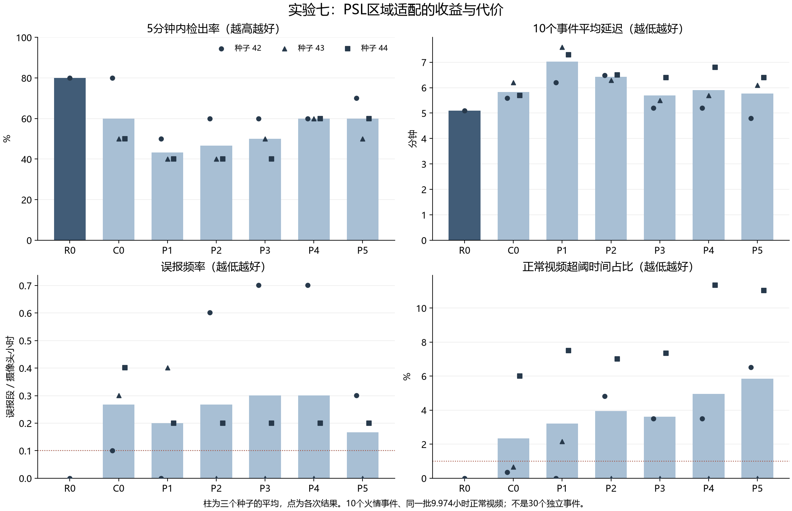
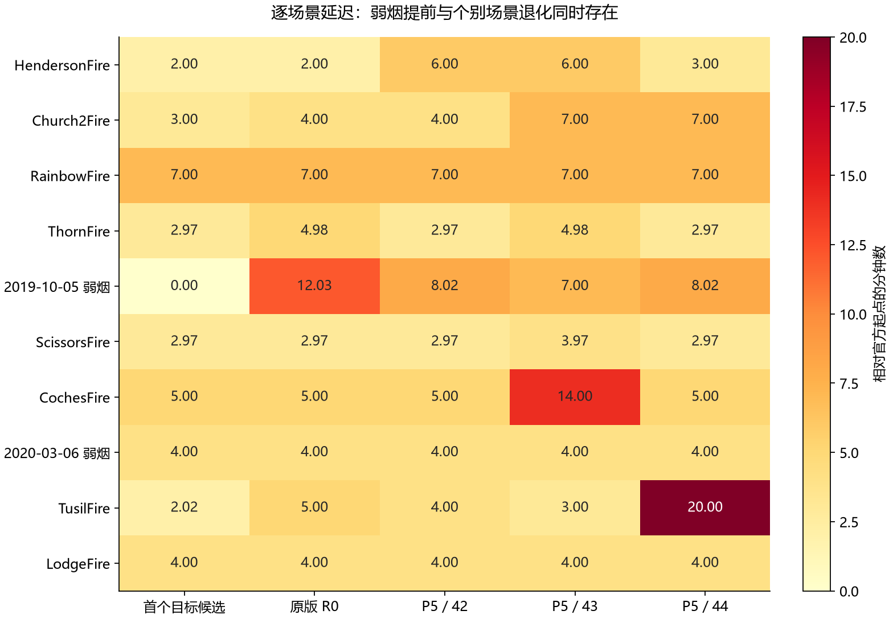

# 实验七深入分析与汇总（2026-10-24）

结论：PSL区域适配在2019弱烟场景上有稳定提前，但没有带来稳定的总体改善。建议保留为研究分支，以原版作为当前主参考；下一轮优先解决正常背景覆盖不足、原判决被新头破坏以及多候选排序问题。

## 一、结果完整性与比较口径

已核对18个正式模型检查点（6方法×3种子）、三个种子的训练/验证标签指纹、协议与代码指纹、冻结阈值、测试标签及场景资格指纹。对每个种子的812条预测逐条对照冻结候选记录，并另写算法从预测重算火情事件延迟和正常视频时间积分，210个“事件×方法×种子”记录及正常误报统计均与原报告一致。原实验六的五方法复评也重算通过。没有重训、改变阈值、改标签或覆盖已有实验结果。

所有本轮方法最终均检出10/10。这是同一组10个事件在三个种子下重复评估，不能当作30个独立事件；正常视频也始终是同一批9.974小时，不能视作三倍独立观察时长。R0使用本轮验证集阈值0.5411153，不是官方默认阈值。

## 二、整体结果

表中指标为三个种子的算术平均；原版结果固定。中位延迟保留三个种子的范围；平均延迟对每次完整10个事件等权计算，再平均三个种子。因为本轮没有漏检，平均延迟的事件集合可直接对齐。

| 方法 | 内容 | 5分钟内检出率 | 10分钟内检出率 | 平均延迟/min | 中位延迟范围/min | 误报段/小时 | 正常超阈时间占比 |
|---|---|---:|---:|---:|---|---:|---:|
| R0 | 原版 | 80.0% | 90.0% | 5.10 | 4.49 | 0.000 | 0.00% |
| C0 | 普通外观融合头 | 60.0% | 93.3% | 5.83 | 4.00—5.50 | 0.267 | 2.34% |
| P1 | 每类1个原型 | 43.3% | 80.0% | 7.03 | 5.49—7.00 | 0.201 | 3.22% |
| P2 | 每类2个原型 | 46.7% | 90.0% | 6.43 | 4.50—6.50 | 0.267 | 3.95% |
| P3 | P2+BES | 50.0% | 96.7% | 5.70 | 4.50—6.50 | 0.301 | 3.61% |
| P4 | P2+PUO | 60.0% | 96.7% | 5.90 | 4.50—5.00 | 0.301 | 4.95% |
| P5 | P2+BES+PUO | 60.0% | 93.3% | 5.76 | 4.00—5.49 | 0.167 | 5.85% |

BES是本实现中的散度约束；PUO是本实现中的原型更新约束。实验是冻结Pyronear/DINOv2特征的区域分类适配，不是原像素级PSL论文的完整复现。

完整P5相对原版：最终检出数相同；5分钟内检出率从80%降到平均60%；平均延迟由5.10升到5.76分钟，约慢40秒；正常视频误报由观察到的0升到平均0.167段/小时，超阈时间占比从0升到5.85%。P5相对普通C0的平均延迟只快约4秒，5分钟内检出率同为60%，超阈时间占比却由2.34%升至5.85%。因此不能把复杂度增加直接解释为有效提升。

也应保留积极结果：P3/P4的10分钟内检出率平均96.7%，P5为93.3%，高于原版90%。这与2019序列从12分钟提前至7—8分钟有关；同时，一些原版5分钟内检出的场景被推到5—10分钟，所以5分钟指标反而下降。它体现报警时点在事件间的重新分配，不宜只选一个时间窗口宣布胜出。

P3相对P2的平均延迟从6.43降至5.70分钟，BES存在局部收益；但其误报频率增加。P4、P5把中位延迟拉近原版，仍未解决异常长延迟、误报占用及种子不稳定。

图中的红色虚线分别是协议校准目标0.1误报段/小时和1%超阈占比，用于参照；不是统计显著性界线。

## 三、逐场景：哪里有进步，哪里被拖慢

| 场景 | 原版/min | P5种子42/min | P5种子43/min | P5种子44/min | 解释 |
|---|---:|---:|---:|---:|---|
| HendersonFire | 2.00 | 6.00 | 6.00 | 3.00 | 原版已到候选下限，新头反而推迟1—4分钟 |
| Church2Fire | 4.00 | 4.00 | 7.00 | 7.00 | 两次由4分钟推迟至7分钟 |
| 2019-10-05（vo-n） | 12.03 | 8.02 | 7.00 | 8.02 | 三次均提前约4—5分钟，但尚未在0分钟极弱烟阶段报警 |
| CochesFire | 5.00 | 5.00 | 14.00 | 5.00 | 种子43推迟9分钟，说明稳定性不足 |
| 2020-03-06（ml-s） | 4.00 | 4.00 | 4.00 | 4.00 | 三次与原版相同，均在首个已确认目标候选出现时检出 |
| TusilFire | 5.00 | 4.00 | 3.00 | 20.00 | 种子44受最高分区域排序影响，主指标推迟到20分钟 |

2019序列人工确认从0分钟有极弱烟、+6至+7分钟相对明显。原版12.03分钟，P5为8.02、7.00、8.02分钟；这是本轮最清晰且跨种子一致的积极信号。它更接近烟变明显的阶段，尚不能说明解决了最早期极弱烟识别。

原版有6/10个场景已在现有候选及标注允许的最早时间检出：Henderson、Rainbow、Scissors、Coches、2020替代序列、Lodge。对这些场景，单独更换候选分类头无法早于正确候选出现时间；需要重点避免将已很早的报警延后。剩余4个事件合计有18.03分钟的候选后延迟，其中2019序列占12.03分钟，约66.7%；因此潜在收益本身高度集中。

Tusil需要特别解释：种子44的P5在+2.02分钟就已给正确目标候选超过自身阈值的分数0.7235，但同帧另一个标注为“烟、非本次指定目标”的候选分数0.8623更高。主评价只接受最高分区域，因此直到20分钟才算正确目标检出；P4相同机制下达到24分钟。这个现象是目标排序/关联问题，不能表述成“模型20分钟都没认出烟”。本次沿用冻结评价标准，未为改善数字而更改口径。

## 四、误报集中在哪里，为什么不能只看次数

P5三个种子的误报段数分别为3、0、2，超阈分钟数分别为39.05、0、66.00。约97.1%的超阈时长来自同一段 normal_20261016_Q5_ws-s-mobo-c；其余主要来自sm-n正常片段。新PSL分支的主要误报集中点是ws-s，不能把实验六另一方法在其他场景上的诊断直接照搬过来。

种子44中，ws-s累计63.95分钟超阈，但按5分钟释放合并规则只计1段误报，该段从起点到终点跨72分钟。P5看起来比部分消融组误报“次数”少，有一部分是报警更容易连接成长段，并不代表长期报警占用更低。建议同时报告误报段/小时、超阈时间占比、最长误报段和连续误报片段。

已查看ws-s代表性原图，候选位于远处地平线附近的淡色背景，而非天空中大块亮云。一个窗口原版分数约0.0107，P5种子44分数约0.8136并超过自身阈值。这些是不同模型的评分，不应解释为同一尺度的置信度增幅。该片段误报候选的age_seconds可达960秒，说明有长时间沿用旧候选框的情况；0秒的新鲜候选中也有误报，因此简单删除旧框不能包治此问题。

## 五、为什么会出现这种结果

下面前两项和原型计数是可直接核对的事实；它们与误报增加之间的因果强度仍需下一轮受控消融验证。

1. 正常背景的有效监督覆盖不足。实际训练是971个候选：714烟、257背景。257个背景来自6个序列，其中只有1个独立正常片段提供有效候选，即signal-s的83个；其余负例来自火情视频背景。虽然训练有9段已确认正常片段，其他多数没有可训练候选，无法为候选分类头提供更多背景多样性。验证集也只有2个独立正常片段实际提供候选，连续正常校准时长7.9475小时。

2. 新头主要学习当前帧外观。它取当前帧16个DINOv2格点均值，再与原版logit、轨迹长度、平均检测置信度、候选数融合；没有直接学习8帧烟羽增长/扩散，也没有把距最近真实检测的age_seconds直接输入。原版logit间接保留时序信息，但未设置维持原版高置信正确判决的约束。它既可能补强弱烟，也可能把本来被原版抑制的静态背景提高到阈值上方。

3. 多原型不一定形成有效分工。种子42的P2烟样本最近原型计数是707/7，P3是713/1，推理最近原型分配几乎只用一个。小批次Sinkhorn分配均衡，不等于实际推理时两个原型都被充分使用。不能据此声称学会了薄烟、浓烟、云雾等语义子类。

4. PUO改善了占用均衡，但不足以保证泛化。种子42的P5烟原型占用变为381/333；同时误报时间和目标排序仍退化，说明“原型用得更均衡”与“最终报警更可靠”是不同目标。原始空间中原型余弦相似度高也不能直接判为PUO实现失效，因为该适配约束采用散度度量，不是原始欧氏空间逐向量正交。

5. 数值崩溃不支持作为本轮主要解释。18个训练均正常早停，最佳轮次为第2—4轮；P3/P5六次训练的BES在全部记录批次都激活。训练损失持续下降时验证损失多有回升，符合有限场景监督下的过拟合迹象。C0平均最佳验证BCE为0.4484，P5为0.4626，当前复杂模型在这个验证指标上也没有优势。

6. 后续检查点诊断发现BES优化方向风险。对P3/P5的6个最佳检查点，按各种子的序列等权采样规则各生成16个批次，86/96批次的底部8个特征值全部为负；共768个底部特征值中745个显著为负。当前目标为`1 / (sum(abs(bottom_eigenvalues)) + epsilon)`，负值变得更负也会使损失下降，所以损失有限、激活或下降不能直接证明类别正向分离改善。该绝对值选择保留自作者代码；当前散度构造及区域样本条件需要单独验证，不能由此认定BES是总体退化的唯一原因，P3相对P2仍有部分指标改善。这些数值来自保存的最佳模型上的重新抽样，不是历史训练全过程记录。复算18个检查点的测试分数，与保存结果最大绝对差为5.364418×10⁻⁷。详见[诊断数据](psl_failure_diagnosis.json)与[只读复算脚本](diagnose_psl_failure.py)。

早检监督也有结构性不足：714个烟训练候选中，0～5分钟45个、5～10分钟74个、10分钟以后595个。按实际序列采样权重重算，0～5分钟占烟正例质量6.85%，10分钟以后占83.57%。新头使用当前帧空间均值并重新输出最终分数，原版权重冻结并不等于原判决受保护。例如Henderson第2分钟正确候选在R0下已过阈，P5种子42未过其自身阈值，最终报警延至第6分钟。不同模型分数使用各自冻结阈值，不将分数数值直接解释为同尺度概率变化。上述实现和数据事实支持后续受控验证，尚不能分摊各因素对最终指标的独立因果贡献。

## 六、和实验六旧方法放在一起看

旧五方法在同一修订诊断集上冻结复评：原版10/10、中位4.49分钟、正常误报0；直接均值残差9/10、中位4分钟；学习残差9/10、中位3分钟、误报0.501段/小时。两个残差法漏掉的都是2019弱烟序列。

因此，学习残差中位延迟更低不能单独当作胜出，它同时漏掉了一个较难事件。原实验六原版的8/10变成现在10/10，是替换两个争议场景造成的样本集合变化，原版算法没有因此改进。本轮PSL恢复对2019序列的检出并较原版提前，但仍没有同时获得更早报警、低误报和跨种子稳定性。旧方法只有冻结种子42，不能把它当作完整三种子对照。

## 七、下一轮的建议与验收条件

建议保留R0为主参考，P5保留研究分支。下一轮可验证以下三项，不预先声称一定有效：

- 扩大困难正常背景覆盖：增加跨摄像头、跨时间、天气与地平线背景的正常候选，重点覆盖低检测置信度、旧框及淡色背景。当前ws-s失败样本可以进入下一轮开发池，但一旦用于训练，应另留新的摄像头/日期作为测试，不能用同一片段证明泛化。验证和测试各补更长连续正常视频，至少30小时作为低误报初步验证起点。
- 保护原有早检能力：测试限幅的logit残差、原版一致性约束，以及依据候选新鲜度的门控；保留原版高置信正确报警，并专门评估早期弱烟窗口。只有在独立正常视频上同时满足误报次数与时长约束，才能接受弱烟提前收益。
- 单独解决区域排序：针对Tusil这类已识别正确烟但被其他区域压住的情况，增加时序关联或候选排序约束。先核实产品是只输出一个框还是允许多框；分别保留最高分目标定位和任一正确目标候选过阈指标，不在当前测试上事后换指标。

验收建议：除最终检出率外，同时检查5分钟内检出率、事件配对提前/延后数、平均与中位延迟、误报段/小时及超阈时长。必须验证弱烟提前不是以明显拖慢已有6个候选下限事件为代价。BES/PUO的系数和原型数只在开发/验证上选择，不根据本次测试反复调到最好。

## 八、解释边界

这是修订诊断集，原8个事件已用于开发分析，2个替代序列与官方模型预训练数据是否重叠未知；结果不能宣传为新的独立泛化成绩。当前正常观察仅9.974小时，原版观察零误报不代表真实误报率为零；若额外假设平稳Poisson过程，零误报对应的单侧95%上界仍约0.300段/小时，并未证明低于0.1段/小时。

## 九、复算与文件用途

- analyze_results.py：只读核查检查点、记录与指标并复算结果；原环境中可直接运行。
- analysis.json：完整数值、监督覆盖、原型计数、误报段及证据核查。
- method_summary.csv：方法汇总；event_details.csv：210条逐事件方法种子记录。
- method_comparison.png：四个总体指标与种子差异；per_event_delays.png：逐场景候选下限、原版与P5延迟。
- source_inventory.json：输入文件的路径与SHA256，用于追溯。
- diagnose_psl_failure.py、psl_failure_diagnosis.json：只读复算最佳检查点的预测、早期样本比例、原型与BES行为；不重训、不重新选阈值。诊断脚本可用`--stdout`输出JSON。
- sources.json、answer-sources.html及psl-diagnosis-sources.json/html：仅用于本地对话的证据卡片，不随本次Git归档。
